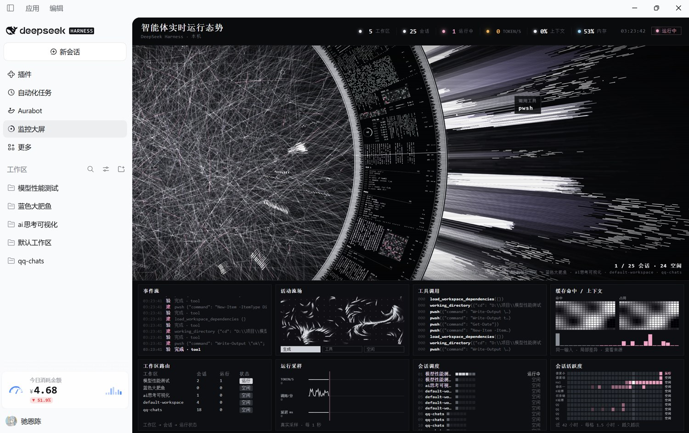

# 智能体实时运行态势（dsh-workflow-monitor）

> DeepSeek Harness 的一块「仪器墙」：把整个 harness 的工作区、会话、事件与用量，铺成一屏可读的实时态势。
> 近黑白、极小字、高密度——像实验台上的监视终端，而不是普通的 Web 仪表盘。



> **非商业许可。** 本项目视觉与构图改编自 [HALOFLUX](https://github.com/Ryder191/haloflux)，
> 继承其 PolyForm Noncommercial License 1.0.0：可学习、可自用、可修改，**不可商用**。
> 详见 [LICENSE](LICENSE) 与 [NOTICE](NOTICE)。

---

## 1. 它是什么

一个 DeepSeek Harness 客户端插件。刷新后左侧导航出现「监控大屏」，点开即整屏态势。

**上方**是一条身份与读数带：`智能体实时运行态势` + 环境行 + 6 个指标灯 + 时钟 + 状态胶囊。
**中间**是旋转的数据墙（细线蛛网 / 白色粒子爆流 / 密排微文字），墙上的微面板标题是实时指标码。
**下方**是 2×4 共 8 块遥测面板。

## 2. 顶部指标栏（6 个，全部真实）

| 指标 | 数据来源 | 实现 |
|---|---|---|
| **工作区** | `useWorkspaces()` 的 `items` | 统计有会话的工作区数；灯亮=有工作区 |
| **会话** | `useSessions()` 的 `byId` | 排除 `blank` 空会话后计数 |
| **运行中** | `useSessionStatus()` 的 `Map<id,{running}>` | 优先用实时状态，回退行上的 `running`；灯为粉色 |
| **TOKEN/S** | 流式 `assistant/live-chunk` 的文本增量 | 每 600ms 取增量字符数 ÷ 实际间隔，再做 `0.6/0.4` 指数平滑。**三档灯**：<10 琥珀（慢，查供应商/网络）、10–80 冰蓝、>80 亮白；无会话运行时熄灭 |
| **上下文** | `assistant/message.usage.inputTokens` | 以 128k 为分母取占比 |
| **内存** | Host 半边 `os.totalmem()/freemem()` | 随 payload 每 30 秒刷新。**三档灯**：<75% 冰蓝、75–90% 琥珀、>90% 红色带脉冲，数字同步变色 |

右侧还有一个状态胶囊：有会话运行 → `● 运行中`（粉），否则 `○ 休整`。

## 3. 下方八块面板

| 面板 | 内容 | 真实数据？ | 实现要点 |
|---|---|---|---|
| **事件流** | 最近 14 条事件：工具调用、步骤、结果 | ✅ | 订阅活跃会话 `eventSource` 快照，取 `tool/call`、`tool/result`、`turn/step`；动词压缩为 读/建/验/问 |
| **活动流场** | 粒子流 + 三态灯（生成/工具/空闲） | ✅ 驱动真实 | **保图案换驱动**：流场函数不变，`Tflow += dt×(0.25+1.9×活跃度)`；活跃度=运行会话数+最近事件。三态有质的差异：空闲 32% 粒子/短拖影/0.30 亮度，生成 100% 粒子/4.4 倍拖影/0.92 亮度，工具调用时中心放射 14 条粉色短须 |
| **工具调用** | 最近 10 次工具名与参数 | ✅ | `tool/call` 的 `name` + `arguments`，逐行累积 |
| **缓存命中 / 上下文** | 左场=缓存命中率，右场=上下文占用，底部柱=输出 token 分布 | ✅ | **保几何换驱动**：原作的热力网格与动效原样保留，只把相位/振幅/斑块位置接到 `cacheHit` 与 `ctxFrac`；直方图喂 `log10(outputTokens)` 分布 |
| **工作区路由** | 工作区 → 会话数 → 运行数 → 状态 | ✅ | 双端取归属：先读工作区记录的成员列表，再读会话行的 `workspaceId`，都没有归入「未归组」 |
| **运行采样** | TOKEN/S、调用·分、延迟 ms 三条曲线 | ✅ | 每秒采样，环形缓冲 60 点，各自自动量程；横轴持续滚动（运动感来自滚动，不伪造波形） |
| **会话调度** | 每会话一行：序号、工作区、活动格、状态 | ✅ | 行标签取会话名前 3 字；点击弹出 DOM 抽屉（工作区/状态/会话 ID，Esc 关闭） |
| **会话活跃度** | 28 列 × 1.5 小时 = **42 小时**活动矩阵 | ✅ | Host 读会话日志按 1.5 小时切桶。**越久越淡**：0–14h 100%、14–28h 62%、28–42h 32%，42h 外不画 |

中央还有一个相位框（带引线的小方框），显示真实相位：**生成中 / 调用工具 / 思考中 / 运行中 / 空闲**。

## 4. 数据从哪来（全部只读）

| 来源 | 用途 |
|---|---|
| `props.useSessions((s)=>s)` → `{byId, ids, phase}` | 会话列表、标题、running、blank |
| `props.useSessionStatus((m)=>m)` → `Map<id,{running}>` | 实时运行态 |
| `props.useWorkspaces((s)=>s)` → `{items, archivedSessionIds}` | 工作区名与归属 |
| `ctx.sessions.binding(id).eventSource` | 活跃会话的持久事件与流式增量 |
| Host 半边 `os` / 会话日志 | 内存占用、42 小时活动桶、今日/7 天用量 |

所有宿主读取都包在 `try/catch`；宿主未提供某 store 时用空形状兜底，钩子顺序保持稳定。

### Host 半边（唯一的服务端逻辑）

`index.js` 注册一条命名路由 `/workflow-monitor/usage-v2`，返回：

```json
{ "at": 0, "bucketMs": 5400000, "columns": 28,
  "rows": [{ "id": "session-…", "buckets": [ … 28 … ], "last": 0, "total": 0 }],
  "usage": { "today": {…}, "days": [ …7… ], "models": [ … ] },
  "mem": { "total": 0, "free": 0, "used": 0 } }
```

- 会话日志是**拼接 zstd 帧**（每次追加一帧），Node 的一次性解压与流式解压都只返回第一帧；`host/history.mjs` 按魔数 `28 B5 2F FD` 切帧后逐帧解压（实测 3454 帧 → 5792 事件，2.3 秒）。
- 路由用 `ctx.webServer.register({ kind:'exact', path, handler })` 注册；**冷启动时用 `ctx.inject(['webServer'])` 等待服务就绪**，否则插件会先于服务激活而注册失败。
- 聚合结果缓存 30 秒。

## 5. 安装

三种方式任选，装完**刷新页面**，左侧导航出现「监控大屏」即成功。

### 方式 A：让 AI 帮你装（推荐）

把下面这段原样发给 DeepSeek Harness：

> 请帮我安装这个插件：`https://github.com/chienchen-png/dsh-workflow-monitor`。
> 把它克隆到本机任意目录，然后用 `plugin_manager` 的 `install_bundle` 指向该目录安装。
> 装完告诉我要不要刷新页面、以及左侧导航里入口叫什么名字。
> **完成相关部署后删除所有下载辅助的相关文件。**

### 方式 B：从 GitHub 直接装

```text
dsh plugin --profile desktop add github:chienchen-png/dsh-workflow-monitor
```

### 方式 C：本地目录装

```text
plugin_manager install_bundle  target=<本目录绝对路径>
```

卸载：`plugin_manager remove_bundle target=dsh-workflow-monitor`

## 6. 构建与自检

```bash
node build.mjs && node --check client.js
```

⚠️ `node --check client.js` **检查不到内联在 scene.html 里的脚本**。场景代码要单独验：

```bash
# 抽出 <script> 内容后
node --check scene-inline.mjs
```

离线预览（无需 DSH）：

```bash
python -m http.server 8791 --bind 127.0.0.1 --directory .
# http://127.0.0.1:8791/lab/host.html?mode=run|idle|void&mock=history
```

## 7. 借鉴与改进

**借鉴自 HALOFLUX（Ryder191）**：旋转数据墙、环带微面板、白色粒子爆流、细线蛛网、扫描线暗角、镜头推拉；`src/scene.html` 是其 `lab.html` 的改编版。

**借鉴自 dsh-haloflux（Ke-wood）**：DSH 插件形态（`dsh.bundle` + `dsh.client` + `cordis.patch.yml`）、事件适配思路、单文件 `client.js` 构建方式。

**我们改了什么**

| 方向 | 改动 |
|---|---|
| 语言 | 面板标题/表头/状态全中文化；4px 微码保留拉丁（中文在 4px 不可读） |
| 语义 | 从「一会话一光环」改为「环带按工作区分段」；矩阵按会话 × 时间 |
| 保图案换驱动 | 差异场、粒子流场都**不动几何/动效**，只把驱动量换成真实指标 |
| 数据层 | 新增 Host 半边：zstd 分帧读日志、42 小时活动桶、内存、用量聚合 |
| 三态机 | run/idle/void + 900ms 标量缓动 + 空闲自动运镜；`camera` 由状态机独占 |
| 交互 | 会话行 → DOM 抽屉；canvas 不承载可读文字与点击 |
| 清理 | 移除原作的 BGM、56 参数控制台、流体力学假公式与假按钮，改为真实状态灯 |

## 8. 已知限制

- 场景在 iframe 中：同源才能直接调用 `contentWindow.__HF`，否则回退 `postMessage`
- 环上 4px 微面板**标题**真实，块内容是随机生成（唯一未接真数据的部分）
- 宿主路由名带版本（`usage-v2`）：宿主不会在插件重载时释放旧路由，改路径是绕开残留注册的办法
- 依赖宿主内部约定（`sidebar.panellist` / `main` / 标准 props / `webServer.register`），DSH 升级后若白屏先查这里
- 内存为**全机占用**，非本进程占用

## 9. 致谢

- **HALOFLUX** — Ryder191（RYDER CODE / Ms MAIKEBAIs CAT），<https://github.com/Ryder191/haloflux>
- **dsh-haloflux** — [@Ke-wood](https://github.com/Ke-wood)，<https://github.com/Ke-wood/dsh-haloflux>

## 10. 许可

PolyForm Noncommercial License 1.0.0（继承自 HALOFLUX）。非商业使用免费；**禁止任何商业用途**。再分发须保留 `LICENSE` 与 `NOTICE`。
