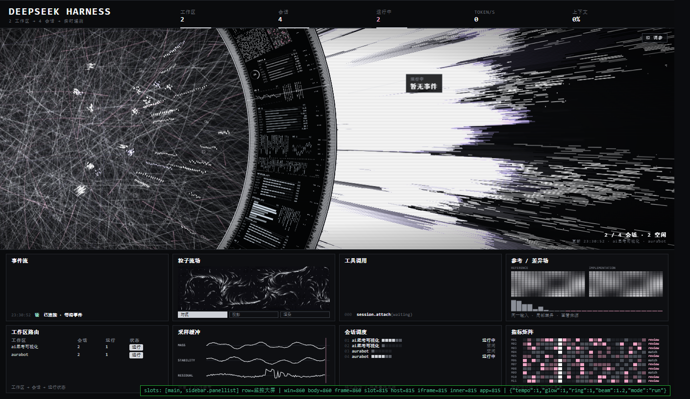

# 智能体实时运行态势（dsh-workflow-monitor）

> 一块近黑白的「仪器墙」插件：把 DeepSeek Harness 里所有工作区与会话的运行状态，铺成一整屏可读的态势画面。
> 旋转的数据墙每一段属于一个工作区，底部八块面板是实时事件流、工作区路由、会话调度与指标矩阵。



> **非商业许可。** 本项目的视觉与构图是 [HALOFLUX](https://github.com/Ryder191/haloflux) 的改编作品，
> 因此**继承其 PolyForm Noncommercial License 1.0.0**：源码可见、可学习、可自用、可修改，
> **不可用于任何商业用途**（含公司内部使用、收费产品、接单交付、付费课程）。详见 [LICENSE](LICENSE) 与 [NOTICE](NOTICE)。

---

## 1. 这是什么

DeepSeek Harness 的客户端插件。安装后，左侧导航多出一个入口，点开就是一整屏的态势画面：

- **顶部**：左侧是身份（标题 + 运行环境），中间是五个读数（工作区 / 会话 / 运行中 / TOKEN/S / 上下文），右侧是时钟与状态胶囊（`● 运行中` / `○ 休整`）
- **中央**：旋转的黑色数据墙，挂满微文字、波形、矩阵；墙外是白色粒子爆流，左侧是细线蛛网
- **底部**：2×4 遥测面板 —— 事件流、粒子流场、工具调用、参考/差异场、工作区路由、采样缓冲、会话调度、指标矩阵

它不是装饰壁纸：所有文字与数字都来自真实会话（KPI、工作区归属、每会话状态、工具调用、事件流、相位），
canvas 只负责氛围，可读信息全部是 DOM。

## 2. 安装

三种方式，任选其一。装完**刷新页面**，左侧导航出现「监控大屏」入口即成功。

### 方式 A：让 AI 帮你装（推荐，不用敲命令）

把下面这句话原样发给 DeepSeek Harness 的对话框：

> 请帮我安装这个插件：`https://github.com/chienchen-png/dsh-workflow-monitor`。
> 把它克隆到本机任意目录，然后用 `plugin_manager` 的 `install_bundle` 指向该目录安装。
> 装完删除所下载的冗余文件，告诉我要不要刷新页面、以及左侧导航里入口叫什么名字。

AI 会自己克隆、安装、并告诉你下一步。

### 方式 B：从 GitHub 直接装

```text
dsh plugin --profile desktop add github:chienchen-png/dsh-workflow-monitor
```

### 方式 C：本地目录装

```text
plugin_manager install_bundle  target=<本目录绝对路径>
```

卸载：

```text
plugin_manager remove_bundle  target=dsh-workflow-monitor
```

> **暂未发布到 npm**，所以不在社区市场的搜索目录里。GitHub 安装与本地安装都完全可用。
>
> 实测于 DeepSeek Harness Desktop `2.0.22-next`（内核 `@deepseek-ai/dsh-* 0.2.2-rc.1`）。
## 3. 视觉语义

| 元素 | 含义 |
|---|---|
| 数据墙分段 | 一段 = 一个工作区；段间细亮分隔线，相邻段色温微差 |
| 墙上微面板标题 | 实时指标短码：`WS 2`、`SESS 4`、`STEP 0`、`TOKEN/S 0`（4px 只放拉丁，中文会糊） |
| 相位框 | 生成中 / 调用工具 / 思考中 / 运行中 / 空闲（依据最近事件类型与时间） |
| 事件流 | 活跃会话的真实事件：工具调用、工具结果、步骤；动词用 读/建/验/问 |
| 工作区路由 | 工作区 → 会话数 → 运行数 → 运行/空闲 |
| 会话调度 | 每个会话一行：编号、工作区、活动格、状态；点一行弹出抽屉 |
| 抽屉 | 工作区 / 状态 / 会话 ID；`Esc` 或 ✕ 关闭 |

**三态状态机**：`run`（节奏 1.0、固定机位）/ `idle`（节奏 0.34、亮度 0.62、自动运镜巡视）/
`void`（0.18），900ms 缓动过渡，只渐变标量参数、不触发几何重建。
`camera` 由状态机独占，宿主快照只下发静态构图，否则每次推送都会把运镜钉死。

## 4. 数据来源（全部只读）

| 来源 | 用途 |
|---|---|
| `props.useSessions((s) => s)` → `{ byId, ids, phase }` | 会话列表、标题、`running`、`blank` |
| `props.useSessionStatus((m) => m)` → `Map<id, {running}>` | 实时运行状态（优先于列表快照） |
| `props.useWorkspaces((s) => s)` → `{ items, archivedSessionIds, pinnedSessionIds }` | 工作区名与归属 |
| `ctx.sessions.binding(id).eventSource.getSnapshot()` | 活跃会话的 `tool/call`、`tool/result`、`turn/step`、`assistant/message`、瞬态 `assistant/live-chunk` |

所有宿主读取都包在 `try/catch` 里；宿主未提供某个 store 时用空形状兜底，钩子调用顺序保持稳定。
工作区归属**两侧都读**：先看工作区记录里的成员列表（`sessionIds` / `memberIds` / `sessions` / `members` / `children`），
再看会话行上的 `workspaceId`，都没有才归入「未归组」。

## 5. 借鉴与改进

本项目**不是**从零发明，明确交代来源：

### 借鉴自 HALOFLUX（Ryder191）

- 整体美术：旋转数据墙、环带微面板、白色粒子爆流、细线蛛网、扫描线与暗角
- 构图逻辑：巨大的环形带穿过画面、镜头推拉、节拍驱动的节奏
- 场景实现：`src/scene.html` 是原作 `lab.html` 的改编版（保留其版权声明与许可）

### 借鉴自 dsh-haloflux（Ke-wood）

- DSH 插件形态：`package.json` 的 `dsh.bundle` + `dsh.client`、`cordis.patch.yml` 插入行、Host 半边空实现
- 事件适配思路：`sessions.binding().eventSource` 的瞬时事件 + 持久事件组合读数
- 单文件 `client.js` 的构建方式（模块加载器工厂 + 源码片段拼接）

### 我们改了/加了什么

| 方向 | 改动 | 为什么 |
|---|---|---|
| **语言** | 面板标题、表头、状态、相位全部中文化，仅保留 `TOKEN`/`ID` 等专有词与 4px 微码 | 原版全英文，中文用户阅读成本高 |
| **语义层级** | 从「一个会话一个光环」改为**环带分段 = 工作区、段内属于该工作区** | 单会话视角信息太少；工作区才是人理解系统的单位 |
| **事件消费** | 只读事件的**时间形状**（类型/时刻/结果），不读轨迹投影 | 避免依赖宿主内部投影 schema，升级不易碎 |
| **状态机** | run/idle/void 三态 + 900ms 标量缓动 + 空闲自动运镜 | 原版装饰节奏与"系统是否在干活"无关 |
| **构图** | 按面板视口重设 `scale`/`centerY`，固定机位（运行态） | 原版按 16:9 全屏设计，嵌进侧栏旁会失衡 |
| **交互** | 会话行 → DOM 抽屉；canvas 不承载文字与点击 | canvas 内做不了可访问性与锐利文字 |
| **工程** | 场景跑在 iframe 中隔离 CSS；等价宿主工装 `lab/host.html` 可离线验证 | 原版会污染宿主样式，且难以回归测试 |

## 6. 结构与构建

```
dsh-workflow-monitor/
├─ package.json          # bundle 清单 + dsh.client
├─ cordis.patch.yml      # 插入 workflow-monitor 行
├─ index.js              # Host 半边（空实现，仅为让 bundle 可激活）
├─ client.js             # 构建产物（浏览器唯一加载的文件，勿手改）
├─ build.mjs             # 拼接 src/*.js 并把场景 HTML 内联成字符串
├─ src/
│  ├─ scene.html         # 场景（原作 lab.html 的改编版，iframe 内运行）
│  ├─ bridge.js          # 遥测适配：会话/工作区/事件流 → 快照
│  └─ mount.js           # 插槽注册（sidebar.panellist + main）、iframe 宿主
├─ lab/host.html         # 等价宿主工装（假 module loader + 假 store）
├─ tools/                # asar 提取、截图指纹
└─ docs/preview.png
```

```bash
node build.mjs && node --check client.js
```

改完 `src/` 后：重新 `install_bundle`（本地 junction 安装时刷新页面即可）。

离线验证（无需 DSH）：

```bash
python -m http.server 8791 --bind 127.0.0.1 --directory .
# 打开 http://127.0.0.1:8791/lab/host.html?mode=run|idle|void
```

## 7. 已知限制

- 场景在 iframe 中：同源才能直接调用 `contentWindow.__HF`，否则回退 `postMessage`
- 环上 4px 微文字只放拉丁短码，中文在该字号不可读
- 只订阅**活跃会话**的事件流；其他会话仅贡献计数与状态
- 事件流目前每 600ms 全量重扫 `entries`，超长会话应改增量游标（待优化）
- 依赖宿主内部约定（`sidebar.panellist` / `main` / 标准 props）。DSH 升级后若白屏，先查这里

## 8. 致谢

- **HALOFLUX** — Ryder191（RYDER CODE / Ms MAIKEBAIs CAT），<https://github.com/Ryder191/haloflux>
- **dsh-haloflux** — [@Ke-wood](https://github.com/Ke-wood)，<https://github.com/Ke-wood/dsh-haloflux>
- DeepSeek Harness 的插槽与遥测接口

## 9. 许可

PolyForm Noncommercial License 1.0.0（继承自 HALOFLUX）。
非商业使用免费；**任何商业用途均被禁止**。再分发须保留 `LICENSE` 与 `NOTICE` 中的署名。
